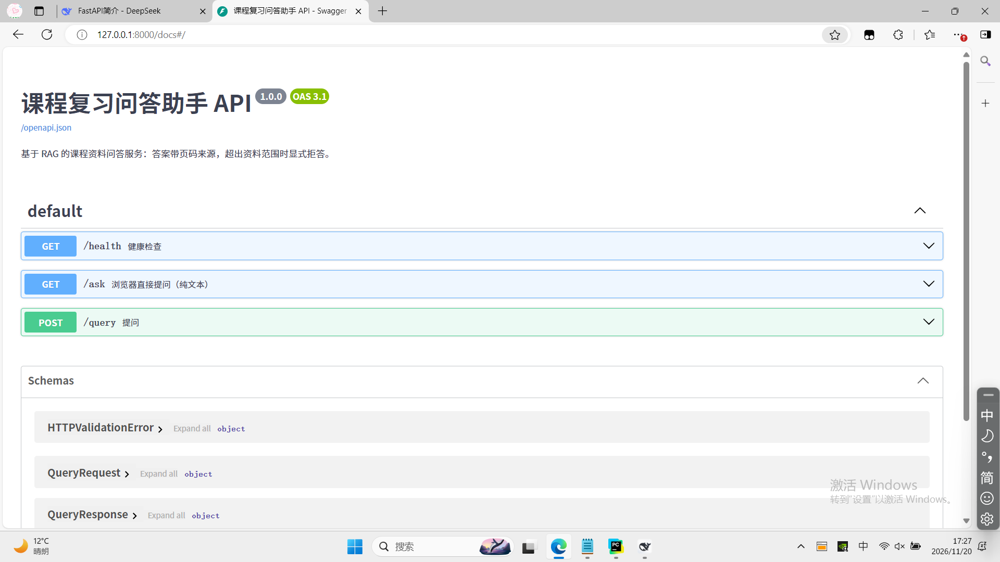
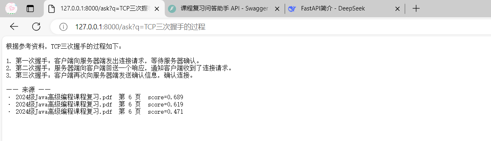
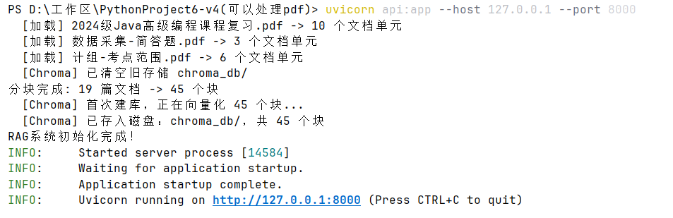

# 课程复习问答助手（RAG）

基于 RAG（检索增强生成）的课程复习问答系统：把多门课的复习资料变成可检索的知识库，
用自然语言提问就能拿到**带页码来源**的答案，超出资料范围的问题会明确拒答而不是编造。

## 为什么做这个

期末复习时，考点散落在几十页 PDF 里，翻找效率低；同学之间反复问同样的考点。
这个系统解决的就是"快速查到某个考点的准确表述，并能回原文核对"。

## 快速开始

### 1. 配置 API Key

嵌入用 SiliconFlow（BAAI/bge-m3），生成用 DeepSeek：

```powershell
setx SILICONFLOW_API_KEY "sk-..."
setx DEEPSEEK_API_KEY "sk-..."
```

> 新开终端后生效。代码只从环境变量读取，不会把 Key 写进文件。

### 2. 安装依赖

```powershell
pip install -r requirements.txt
```

### 3. 准备语料

把复习资料（支持 `.pdf` / `.docx` / `.pptx` / `.txt` / `.md`）放进
`data/sample_documents/`。

### 4. 运行

```powershell
python main.py                # 单次问答（命令行）
uvicorn api:app --port 8000   # 启动 API 服务，浏览器打开 http://127.0.0.1:8000/docs
python eval/run_eval.py       # 跑评估集
```

## 架构

```
                 ┌──────────────────────────────────────────┐
   课程资料       │  doc_loader 多格式加载                            │
   (PDF/PPT/     │   · PDF 按页拆，保留页码                   │
    Word)   ───► │   · PPT 按张拆，保留张号                   │
                 │   · 逐文件容错 + 编码嗅探(utf-8/gbk/utf-16) │
                 └───────────────────┬──────────────────────┘
                                     ▼
                 ┌──────────────────────────────────────────┐
                 │  text_splitter 分块（按句子边界打包                 │
                 │   · 先合并 PDF 伪换行，再按标点切句         │
                 │   · chunk_size=350, overlap=50           │
                 └───────────────────┬──────────────────────┘
                                     ▼
                 ┌──────────────────────────────────────────┐
                 │  vector_store 向量化 + 存储                         │
                 │   · bge-m3 (1024维) via SiliconFlow       │
                 │   · Chroma 持久化 (cosine)                │
                 │   · reset=True：每次启动重建索引            │
                 └───────────────────┬──────────────────────┘
                                     ▼
                 ┌──────────────────────────────────────────┐
                 │  rag_pipeline 检索 → 拼上下文 → 生成                 │
                 │   · Top-K 检索（含页码/张号来源）           │
                 │   · DeepSeek + 防幻觉/禁拼接提示词          │
                 └───────────────────┬──────────────────────┘
                                     ▼
                        带来源的答案（可回原文核对）
```
## API 服务

把 RAG 能力封装为 HTTP 接口，供前端或其它系统调用。

```powershell
uvicorn api:app --host 127.0.0.1 --port 8000
```

| 接口 | 说明 |
|---|---|
| `POST /query` | 提问，返回 JSON：`answer` + `sources`（文件/页码/张号/相似度）+ `elapsed_ms` |
| `GET /ask?q=...` | 浏览器直接提问，返回纯文本答案 + 来源，便于人工核对与演示 |
| `GET /health` | 健康检查：索引块数、模型配置 |
| `GET /docs` | Swagger 交互文档 |





启动日志（一条命令拉起服务，自动加载语料并建库）：



### 服务层设计要点

| 决策 | 原因 |
|---|---|
| **同步端点（`def`）而非 `async def`** | RAG 内部是阻塞网络调用；`async def` 会阻塞事件循环拖垮整个服务，同步函数由 FastAPI 派发到线程池 |
| **`/query` 保留原始 Markdown，`/ask` 做纯文本净化** | 同一内容不同终端不同呈现：前端可能想渲染粗体/列表，人读时要干净 |
| **上游 `'-'` 占位在 API 边界归一化为 `null`** | 避免类型契约冲突（模型声明 `int`，上游给字符串）导致 500 |
| **全局异常处理器** | 避免裸 500 无任何可诊断信息 |

## 关键设计决策

| 决策 | 原因 |
|---|---|
| **PDF 按页拆，页码写进 metadata** | 答案要能溯源到页，用户才能回原文核对；整篇一个向量也会稀释语义 |
| **chunk_size = 350** | 实测"五个环节"这类枚举答案在文档中跨约 210 字，取 210×1.5 留余量，保证一个枚举不被切碎 |
| **分块前先合并 PDF 伪换行** | PDF 按视觉行换行，"可以得/到"会被拆成两行，直接切分会把句子切碎 |
| **bge-m3 + 归一化后点积** | bge-m3 以余弦相似度为训练目标；向量先归一化，点积即余弦，省一次除法 |
| **`hnsw:space=cosine` 必须显式设置** | Chroma 默认是 l2 欧氏距离，与 bge-m3 不匹配，**会让检索质量下降且不报错** |
| **`score = 1 - distance`** | Chroma 返回的是距离，越小越相似；转成相似度才符合直觉和阈值判断 |
| **提示词强调"禁止拼接"** | 曾出现真实幻觉：问"Map 和 Collections 的区别"，库里分别有两者的描述但**没有对比**，模型把两段拼起来还标注了来源 |
| **逐文件容错** | 真实资料里有加密 PDF、扫描件、损坏文件；单个失败不能让整个知识库建不起来 |
| **语料路径基于 `__file__` 解析** | 不依赖当前工作目录；从 Terminal 和 PyCharm Run 运行行为一致（曾因 `./data/...` 相对 CWD 解析，在 PyCharm 里加载到 0 篇文档） |
## 评估

位置：`eval/`（`questions.json` 22 题、`run_eval.py` 评测脚本、`场景说明.md` 需求与判定规则）

### 题型分布（22 题 / 7 类）

| 类型 | 数量 | 测什么 |
|---|---|---|
| `single_hop` | 4 | 单点事实 |
| `enumeration` | 7 | 列举多要点（考验分块与 top_k） |
| `confusable` | 3 | 易混概念（Collection vs Collections、sleep vs wait） |
| `cross_sentence` | 1 | 跨句过程（TCP 三次握手） |
| `unanswerable` | 3 | 明显超出资料范围 |
| `hard_negative` | 2 | 领域内但资料没有 |
| `question_only` | 2 | **问题原文在资料里、但资料没给答案** |

### 指标定义（拆开统计，不只看一个总分）

| 指标 | 定义 |
|---|---|
| 检索命中率 | 期望的文件 + 页码出现在返回的 sources 中 |
| 关键词覆盖 | 期望关键词在答案中的占比（每题的通过线可单独设） |
| 拒答正确率 | 不可答题的答案含拒答标志词 |
| 答案长度合规 | 正文（去空白）≤ 250 字 |
| top1 相似度 | 检索排名第一的分数，低于 0.52 记为"低置信度"（**仅作风险标记，不否决**） |

> 检索分数之所以不直接否决，是因为它只是代理指标：曾因 `top1=0.5376 < 0.55`
> 误判一道答案完全正确的题。

### 结果

| 语料 | 块数 | 题数 | 通过 | 说明 |
|---|---|---|---|---|
| 1 门课 | 27 | 15 | 15/15 | 单课程基线 |
| 1 门课 | 27 | 15 | **14/15** | **反向验证：top_k 3→2**，只有枚举题下降 |
| 3 门课 | 45 | 22 | **22/22** | 扩语料后，原有 15 题不受干扰 |

**反向验证的意义**：证明评估集有区分度，不是一直给满分。

### 优化历程（`eval/reports/runs.jsonl`）

```
15 题基线            15/15
top_k=2 反向验证      14/15   ← 预期内的退化
恢复                 15/15
扩到 3 门课 / 22 题   22/22
```

## 已知局限

- **不支持扫描件**：图片版 PDF 无文本层，会明确报错"可能是扫描件，需要 OCR"，未接入 OCR
- **docx 无页码**：Word 文件没有分页信息，整篇作为一个单元，只能溯源到文件而非页码（改进方向：按 `Heading` 样式切章节）
- **未处理跨页断裂**：知识点若跨两页，每页独立成块，检索可能只拿到一半
- **语料规模小**：3 门课 / 45 块，未在千级文档上验证
- **无 rerank**：仅用向量相似度排序，未加交叉编码器重排
- **服务启动会重建索引**：`SimpleVectorStore(reset=True)`，每次启动重新嵌入全部块
  （当前 45 块，约 3~5 秒）；后续计划改为基于内容指纹的增量重建
- **自动指标是代理**：关键词覆盖可能"含关键词但意思错"，需人工复核

## 目录

```
.
├── api.py                  FastAPI 服务层（/query、/ask、/health）
├── doc_loader.py           多格式加载（PDF/Word/PPT/文本）
├── text_splitter.py        按句子边界分块
├── vector_store.py         嵌入（bge-m3）+ Chroma 存储与检索
├── rag_pipeline.py         检索 → 上下文 → 生成
├── main.py                 手动测试入口
├── docs/                   接口与运行截图
├── legacy/                 早期探索脚本（归档，不参与流程）
├── data/sample_documents/  语料
└── eval/
    ├── 场景说明.md          用户/范围/红线/判定规则
    ├── questions.json      22 道评估题
    ├── run_eval.py         评测脚本
    └── reports/            评估报告与历史
```

## TODO

- [x] 单题失败隔离 + 指数退避重试 + 增量落盘（已做故障注入验证）
- [ ] 基于内容指纹的增量建库（避免每次启动重建）
- [ ] docx 按标题切章节
- [ ] 跨页内容合并
- [ ] 接入 rerank 提升检索精度
- [ ] 重组为 `src/` 包结构